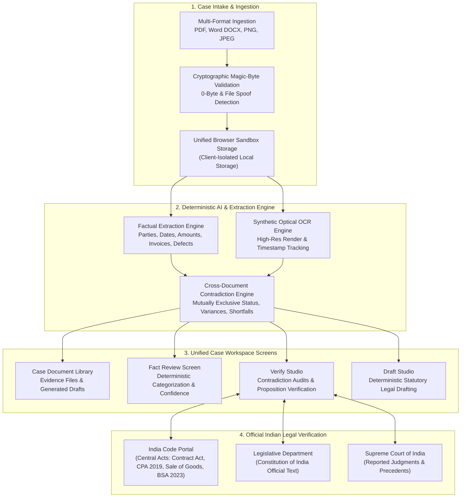

# DraftMate.ai ⚖️

<div align="center">

**Enterprise AI Legal Document Drafting, Cross-Document Contradiction Audit & Statutory Verification Workspace**

[](https://www.typescriptlang.org/)
[](https://react.dev/)
[](https://vitejs.dev/)
[](https://tailwindcss.com/)
[](https://vitest.dev/)
[](https://opensource.org/licenses/MIT)

> **Tagline:** *Draft smarter. Verify deeper.*  
> **Core Promise:** *Draft confidently. Check carefully. Know what needs a lawyer.*

</div>

---

## 📖 Table of Contents

- [Overview & Product Vision](#-overview--product-vision)
- [Architecture & 4-Stage Pipeline](#-architecture--4-stage-pipeline)
- [Key Features](#-key-features)
- [The 6 Demonstration Benchmarks](#-the-6-demonstration-benchmarks)
- [Official Indian Legal Sources Layer](#-official-indian-legal-sources-layer)
- [Security, Safeguards & Neutrality](#-security-safeguards--neutrality)
- [Quick Start Guide](#-quick-start-guide)
- [Automated Testing Suite (62 Tests)](#-automated-testing-suite-62-tests)
- [Project Directory Structure](#-project-directory-structure)
- [Legal & Ethical Disclaimers](#-legal--ethical-disclaimers)

---

## 💡 Overview & Product Vision

**DraftMate.ai** is an AI-powered legal document drafting, multi-file evidence review, contradiction audit, and voice-assisted legal research workspace initially focused on Indian legal use cases.

Modern legal practitioners and business teams waste countless hours reconciling conflicting papers, cross-checking inconsistent dates and amounts across invoices and receipts, and attempting to distinguish authentic legal citations from unverified AI hallucinations.

DraftMate.ai addresses this with a **deterministic verification architecture**:
1. **Never guesses or hallucinates:** Factual extractions are strictly grounded in submitted document text and OCR bounding streams.
2. **Deterministic Contradiction Engine:** Automatically flags conflicting payment assertions (e.g. Paid receipt vs Unpaid statement), arithmetic deduction variances, unverified cash assertions, and delivery shortfalls across multiple files.
3. **Official Legal Sources Layer:** Directly connects to official Indian portals—**Legislative Department** ([legislative.gov.in](https://www.legislative.gov.in/)), **India Code** ([indiacode.nic.in](https://www.indiacode.nic.in/)), and the **Supreme Court of India** ([sci.gov.in](https://www.sci.gov.in/))—verifying legal propositions against authentic gazetted text.
4. **Strict Neutrality:** Never prematurely adjudicates guilt, theft, or fraud; highlights factual discrepancies objectively for human legal counsel review.

---

## 🏛️ Architecture & 4-Stage Pipeline

The application connects its **Case Intake**, **Document Library**, **Fact Review**, **Verify Studio**, and **Draft Studio** to the **SAME underlying matter data**:



---

## 🌟 Key Features

### 1. Case Management & Clean Empty State
- **Production-Ready Multi-Case Support:** First-time users see a clean dashboard with zero hardcoded sample data.
- **Custom Case Intake:** Create matters with Title, Reference Number, Jurisdiction, Matter Type, and Parties with entity classifications (`INDIVIDUAL`, `COMPANY`, `LLP`, `PROPRIETORSHIP`, `GOVERNMENT_BODY`).
- **Isolation:** Fictional demonstration benchmarks are strictly segregated from user-created client matters.

### 2. Multi-Format Evidence Ingestion (.pdf, .docx, .png, .jpg)
- **PDF Extraction:** Extracts selectable text streams, tracks page counts, and flags scanned/image-only documents for OCR.
- **Word Processing (`.docx`):** Mammoth-powered document parsing preserving headings, paragraphs, and clauses in order.
- **Image Evidence (`.png`, `.jpg`, `.jpeg`):** Full OCR support with optical confidence scoring, resolution tracking, format badges, and source provenance.
- **Security Check:** Magic-byte signature verification (`%PDF-`, `\x89PNG`, `\xFF\xD8\xFF`, `PK\x03\x04`) blocks disguised or empty (0-byte) files.

### 3. Case Document Library
- **Case Filter Selector:** View all documents or isolate records to the active legal matter.
- **Two Integrated Views:**
  - **Case Evidence Files:** Format badges (`PDF`, `DOCX`, `PNG`, `JPEG`, `Image Evidence`), OCR confidence, provenance, and interactive thumbnail previews.
  - **Case Legal Drafts:** Inspect, edit in Draft Studio, run Verify Studio audit, duplicate, or export as clean text.
- **Evidence Inspection Modal:** High-resolution modal with an unmissable `[FICTIONAL DEMO EVIDENCE — NOT A REAL DOCUMENT]` banner, extracted text viewer, and chain-of-custody metadata.

### 4. Structured Fact Extraction & Interactive Review
- **Automatic Categorization:** Parties, Dates, Amounts, Payment Statuses, Contract Clauses, Allegations, and Missing Fields.
- **Human-in-the-Loop Review:** Attorneys can Accept, Correct, or Reject extracted facts while preserving immutable original excerpts.

### 5. Cross-Document Contradiction Engine
- **Settlement Status Conflict:** Direct conflict between paid receipts (e.g. `TXN123`) and overdue account statements.
- **Disbursement vs Processing Notation:** Distinguishes internal payroll processing batches from confirmed bank account credit.
- **Arithmetic Divergence:** Verifies itemized calculations (e.g., Deposit ₹30k − Cleaning ₹2k − Repairs ₹3k = ₹25k vs Landlord stating only ₹20k refund).
- **Physical vs Functional Damage:** Distinguishes outer packaging distress from component functional failure.
- **Secondary Evidence Limitations:** Flags uncorroborated cash claims and notes Section 63 BSA 2023 / Section 65B certification requirements for digital screenshots.

### 6. Guided Draft Studio with 6 Statutory Templates
- **Template Types:**
  1. `LEGAL_NOTICE_COMMERCIAL_DUES`: Recovery of commercial dues under Commercial Courts Act 2015 & Contract Act.
  2. `SALARY_CLARIFICATION_REPRESENTATION`: Formal representation for salary disbursement and exit clearance.
  3. `SECURITY_DEPOSIT_RECONCILIATION`: Tenancy deposit reconciliation requisition challenging unverified deductions.
  4. `CONSUMER_DEFECTIVE_GOODS_COMPLAINT`: Pre-litigation notice for defective products under Section 35, Consumer Protection Act, 2019.
  5. `LOAN_REPAYMENT_RECONCILIATION`: Friendly loan recovery demand under Contract Act with Section 63 BSA 2023 electronic evidence reservation.
  6. `DELIVERY_DISCREPANCY_JOINT_INSPECTION`: Tripartite joint survey requisition under Sections 37 & 42 of Sale of Goods Act, 1930.
- **Anti-Hallucination Safeguard:** Automatically inserts explicit bracketed placeholders (`[MISSING: ...]`) for unverified information.

### 7. Voice Legal Assistant
- Interactive voice input and spoken audio playback powered by the native Web Speech API (`SpeechRecognition` & `SpeechSynthesis`).
- Answers questions about Indian statutes, procedural timelines, and active case findings.

---

## 🧪 The 6 Demonstration Benchmarks

DraftMate.ai includes **six diverse fictional benchmark cases** covering different areas of Indian law, evidence types, and factual discrepancies:

| Case Ref | Case Title | Classification | Key Evidentiary Discrepancy & Limitation | Included Documents |
| :--- | :--- | :--- | :--- | :--- |
| **`DM-DEMO-001`** | **Aster Supplies v. Northstar Retail** | Commercial Dues | Mutually exclusive payment status: Receipt asserts ₹50k paid via TXN123 on 25 Aug 2026; statement asserts identical balance unpaid on 30 Aug 2026. | • Payment Receipt PDF<br>• Account Statement PDF<br>• Stamped Dock Receipt PNG |
| **`DM-DEMO-002`** | **Priya Sharma v. Meridian Digital Services** | Employment Dispute | Internal payroll processing notation does not prove funds credited to employee bank account. Incomplete date `05-____-2026`; unverified 30-day notice compliance. | • Salary Statement DOCX<br>• Payroll Email DOCX<br>• Appointment Letter PDF<br>• HR Exit Email DOCX<br>• Mobile HR Screenshot PNG |
| **`DM-DEMO-003`** | **Rahul Verma v. Greenview Properties** | Tenancy Deposit | Net calculated refund is ₹25,000 (Deposit ₹30k − Cleaning ₹2k − Repair ₹3k); landlord asserts only ₹20k refund without accounting basis. Missing contractor tax invoices & photos. | • Handover Checklist PDF<br>• Draft Settlement DOCX<br>• Deduction Sheet Image PNG |
| **`DM-DEMO-004`** | **Ananya Mehta v. BrightCart Electronics** | Consumer Defective Goods | Buyer claims cracked laptop display upon arrival; seller claims clean POD sign-off. Photograph proves cracked screen at capture time, but does not prove causation without diagnostic report under CPA 2019. | • Tax Invoice PDF<br>• Courier POD PDF<br>• Support Ticket DOCX<br>• Support Chat PNG<br>• Cracked Laptop Photo JPG |
| **`DM-DEMO-005`** | **Arjun Malhotra v. Karan Sethi** | Personal Loan Dispute | Loan acknowledgment states ₹80,000; electronic UPI transfer substantiates only ₹50,000 (₹30,000 shortfall). Unverified cash claim. Ambiguous "next month" repayment. Electronic evidence requires Section 63 BSA certificate. | • Loan Acknowledgment PDF<br>• UPI Confirmation PNG<br>• WhatsApp Chat DOCX<br>• Lender Ledger PDF |
| **`DM-DEMO-006`** | **Silverline Components v. Dev Industrial Services** | Goods Delivery Shortfall | Supplier dispatched 100 units under SO-2066; consignee GRN records 90 units (10-unit shortfall). Outer carton damage does not prove component destruction without bench testing. Missing carrier LR exception. | • Purchase Order PDF<br>• Dispatch Note PDF<br>• GRN DOCX<br>• Damaged Cartons Photo JPG<br>• Joint Survey Requisition PDF |

---

## ⚖️ Official Indian Legal Sources Layer

Directly indexed against authentic publications from official Indian government repositories:

| Category | Enactment / Precedent | Key Provisions Indexed | Official Source Portal |
| :--- | :--- | :--- | :--- |
| **Constitutional Law** | **The Constitution of India** | **Article 14** (Equality before law), **Article 19(1)(g)** (Trade & profession), **Article 226** (Writ jurisdiction), **Article 299** (Executive contracts) | [legislative.gov.in](https://www.legislative.gov.in/constitution-of-india/) |
| **Contract Law** | **Indian Contract Act, 1872** | **Section 73** (Compensation for breach), **Section 74** (Liquidated damages vs penalty) | [indiacode.nic.in](https://www.indiacode.nic.in/handle/123456789/2187) |
| **Consumer Protection** | **Consumer Protection Act, 2019** | **Section 35** (Consumer complaints), **Sections 83 & 84** (Product liability action) | [indiacode.nic.in](https://www.indiacode.nic.in/handle/123456789/15256) |
| **Commercial Sales** | **Sale of Goods Act, 1930** | **Section 37** (Delivery of wrong quantity), **Section 42** (Acceptance of goods) | [indiacode.nic.in](https://www.indiacode.nic.in/handle/123456789/2390) |
| **Law of Evidence** | **Bharatiya Sakshya Adhiniyam, 2023 (BSA)** | **Section 63** (Admissibility of electronic records and mandatory certificate requirement) | [indiacode.nic.in](https://www.indiacode.nic.in/) |
| **Civil Procedure** | **Code of Civil Procedure, 1908** | **Order XXXVII** (Summary procedure on negotiable instruments / liquidated debts) | [indiacode.nic.in](https://www.indiacode.nic.in/handle/123456789/2191) |
| **Commercial Courts** | **Commercial Courts Act, 2015** | **Section 12A** (Mandatory pre-institution mediation and settlement) | [indiacode.nic.in](https://www.indiacode.nic.in/handle/123456789/2156) |
| **Precedent** | ***Radhakrishna Agarwal v. State of Bihar (1977)*** | Pure contractual disputes cannot bypass civil remedies via Article 226 writ petitions | [sci.gov.in](https://www.sci.gov.in/) |
| **Precedent** | ***Kailash Nath Associates v. DDA (2015)*** | Actual loss must be established for damages under Section 74 Contract Act | [sci.gov.in](https://www.sci.gov.in/) |
| **Precedent** | ***Patil Automation v. Rakheja Engineers (2022)*** | Section 12A pre-institution mediation is mandatory; suits violating it are rejected | [sci.gov.in](https://www.sci.gov.in/) |

---

## 🛡️ Security, Safeguards & Neutrality

- **Magic Byte Cryptographic Inspection:** Inspects raw file buffers to reject disguised file extensions and 0-byte corrupted uploads.
- **Strict Neutrality Engine:** Never adopts an accusatory tone. Factual contradictions are labelled as discrepancies for human legal and financial reconciliation; the software strictly refrains from inferring fraud, theft, or guilt.
- **Zero Hallucination Ground Truth:** Private ground-truth rubrics are isolated from prompt templates to eliminate model context leakage.
- **Client-Side Data Privacy:** Case records are persisted in local sandboxed storage and can be completely cleared at any time from the Settings screen.

---

## 🚀 Quick Start Guide

### Prerequisites
- **Node.js** (v18.0 or newer; tested on Node.js v24.2.0)
- **npm** (v9.0 or newer)

### 1. Clone the Repository
```bash
git clone https://github.com/yyadav2k23/DraftMate.ai.git
cd DraftMate.ai
```

### 2. Install Dependencies
```bash
npm install
```

### 3. Run the Development Server
```bash
npm run dev
```
Open **`http://localhost:5173/`** in Google Chrome or your preferred browser.

### 4. Build for Production
```bash
npm run build
```
Type-checks and compiles the application into `dist/` with zero TypeScript errors.

---

## 🧪 Automated Testing Suite (62 Tests)

Run the comprehensive Vitest test suite:
```bash
npm test
```

### Test Suite Summary:
```
 ✓ src/__tests__/multiCaseEvidenceLibrary.test.ts (11 tests)
   ✓ Six Diverse Demonstration Cases Benchmark (4 tests)
   ✓ Ground-Truth Rubric Runner & Prohibited Conclusions Check (2 tests)
   ✓ Synthetic Evidence Images & Watermark Integrity (1 test)
   ✓ Storage Isolation & Multi-Case Loading (1 test)
   ✓ Multi-Template Draft Studio Coverage (3 tests)

 ✓ src/__tests__/demonstrationAndContradictionAudit.test.ts (21 tests)
   ✓ Three Demonstration Cases Audit (3 tests)
   ✓ Eight Explicit Contradiction & False-Positive Tests (8 tests)
   ✓ Document Ingestion Edge Cases & Security Checks (7 tests)
   ✓ Storage Isolation & Demo Case Management (1 test)
   ✓ Draft Studio Multi-Dispute Template Coverage (2 tests)

 ✓ src/__tests__/auditEngine.test.ts (30 tests)
   ✓ Contradiction detection, neutrality principle, and false positive prevention
   ✓ Magic-byte file validation (PDF, PNG, JPEG, DOCX) and 0-byte rejection
   ✓ Official Indian legal source adapters and proposition verification
   ✓ Health score transparent penalty calculations

 Test Files  3 passed (3)
      Tests  62 passed (62)
   Duration  ~400ms (100% pass rate)
```

---

## 📁 Project Directory Structure

```
DraftMate.ai/
├── server/
│   └── apiRouter.ts                  # Express API router (probes, legal source search, magic-bytes)
├── src/
│   ├── __tests__/                    # 62 Automated Vitest tests
│   │   ├── auditEngine.test.ts
│   │   ├── demonstrationAndContradictionAudit.test.ts
│   │   └── multiCaseEvidenceLibrary.test.ts
│   ├── components/
│   │   ├── cases/                    # Case creation & document upload modals
│   │   ├── common/                   # Reusable UI modals, alerts, and badges
│   │   ├── dashboard/                # Case dashboard with empty state & benchmark suite
│   │   ├── draft/                    # Guided Draft Studio with 6 statutory templates
│   │   ├── export/                   # Audit report exporter (.md, .json, printable)
│   │   ├── facts/                    # Interactive Fact Review studio
│   │   ├── layout/                   # Midnight Navy Shell rail navigation & case switcher
│   │   ├── library/                  # Case Document Library (Evidence Files & Legal Drafts)
│   │   ├── settings/                 # Security settings & local database reset
│   │   ├── sources/                  # Legal Sources Explorer & official source linker
│   │   ├── verify/                   # Verify Studio contradiction auditor & health scorer
│   │   └── voice/                    # Voice Legal Assistant (Web Speech STT/TTS)
│   ├── data/
│   │   ├── demonstrationCases.ts     # The 6 Fictional Demonstration Benchmarks
│   │   ├── legalSourcesData.ts       # Curated Indian Statutes, Constitution Articles & Judgments
│   │   ├── syntheticEvidenceImages.ts# Synthetic SVG evidence graphics with watermarks
│   │   └── testEvaluationRubric.ts   # Private Ground-Truth Evaluation Rubrics & Runner
│   ├── engine/
│   │   ├── citationVerifier.ts       # Legal citation & statutory proposition verifier
│   │   ├── completenessChecker.ts    # Placeholder and missing detail detector
│   │   ├── contradictionDetector.ts  # In-document contradiction detector
│   │   ├── crossDocumentContradiction.ts # Multi-document contradiction engine
│   │   ├── factExtractor.ts          # Structured fact extraction engine
│   │   └── healthScore.ts            # Audit health score calculator
│   ├── services/
│   │   ├── aiProvider.ts             # Deterministic legal drafting engine
│   │   ├── documentParser.ts         # Client file parsing, magic-byte checks, OCR
│   │   ├── sourceAdapters.ts         # Legislative Dept, India Code, Supreme Court adapters
│   │   ├── storage.ts                # Isolated local storage persistence
│   │   └── voiceAssistant.ts         # Speech recognition & speech synthesis adapter
│   ├── types/
│   │   └── index.ts                  # TypeScript models and interfaces
│   ├── App.tsx                       # Root router and active case state coordinator
│   └── index.css                     # Midnight Navy styling & design tokens
├── vite.config.ts                    # Vite bundler with integrated Express API middleware
├── package.json                      # Dependencies and scripts
└── README.md                         # Documentation
```

---

## ⚖️ Legal & Ethical Disclaimers

1. **Informational & Drafting Workspace Only:** DraftMate.ai is an automated informational drafting and evidence auditing software tool. It is **not** a lawyer, law firm, or legal substitute, and does **not** provide legal advice, legal representation, or a guarantee of any legal outcome.
2. **Attorney-Client Privilege:** Interactions and documents processed within DraftMate.ai do **not** create an attorney-client relationship and are not protected by legal professional privilege.
3. **Primary Authority Requirement:** Never rely on automated outputs for court filings or binding agreements without independent review by an advocate qualified to practice in the relevant Indian jurisdiction.
4. **Fictional Test Matters:** All demonstration cases, parties, addresses, identification numbers, and transactions are strictly **fictional benchmark fixtures** created for testing software capabilities. Any resemblance to real persons or actual disputes is purely coincidental.
